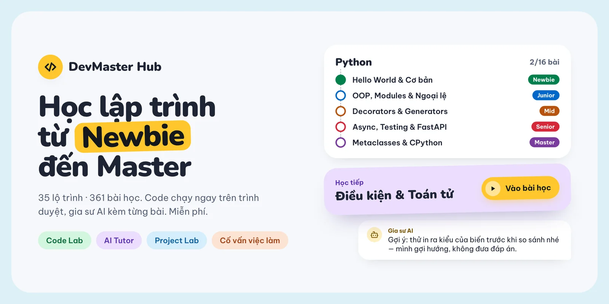
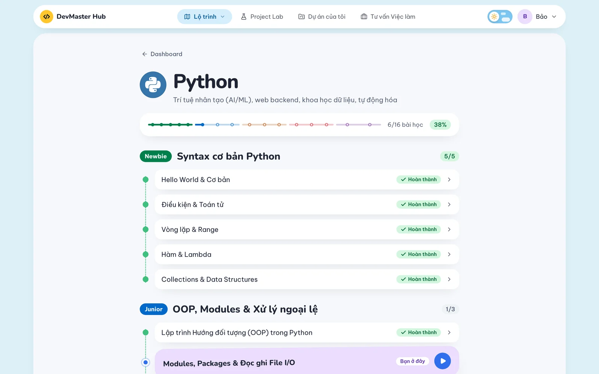
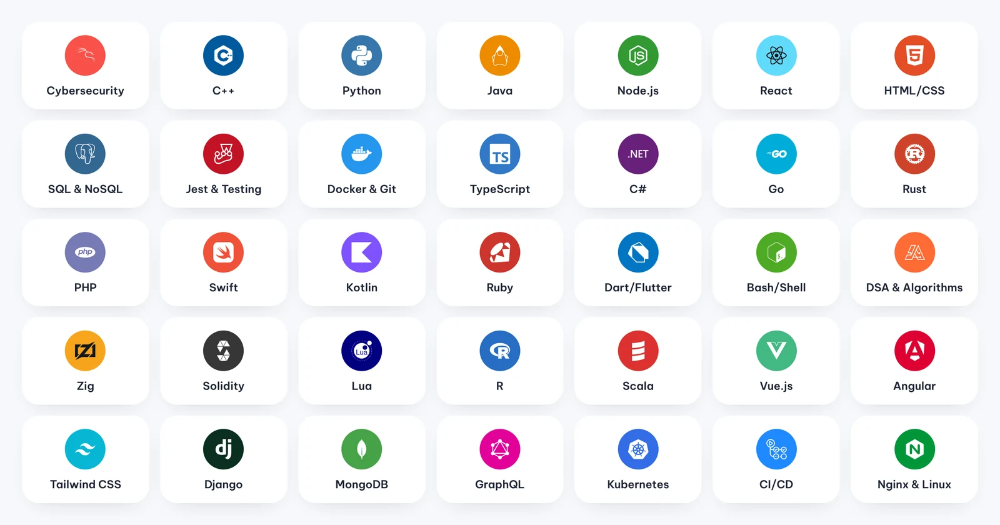
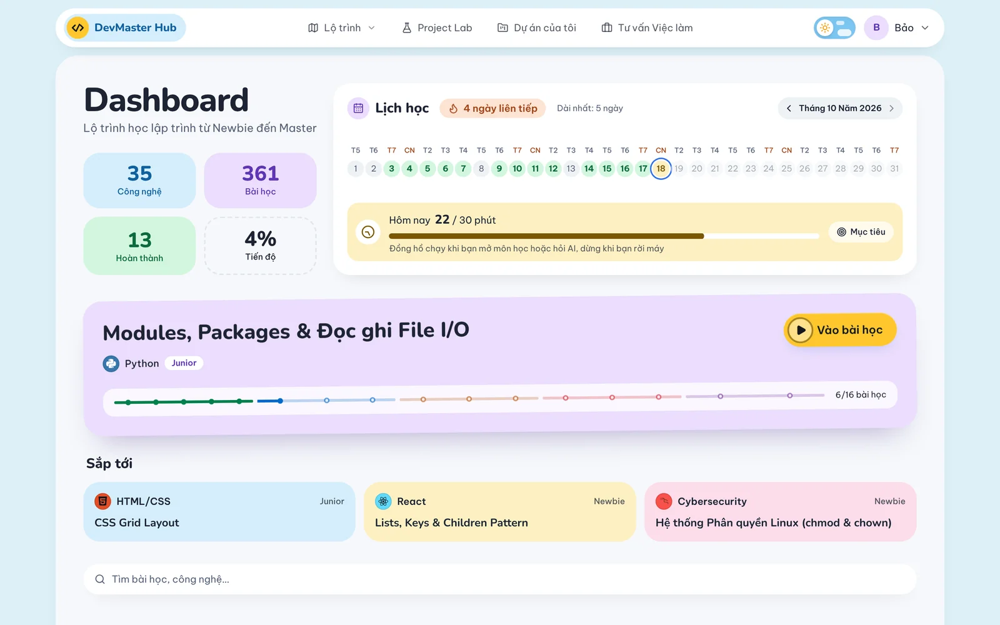
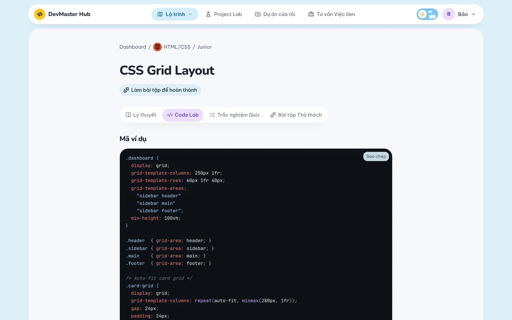
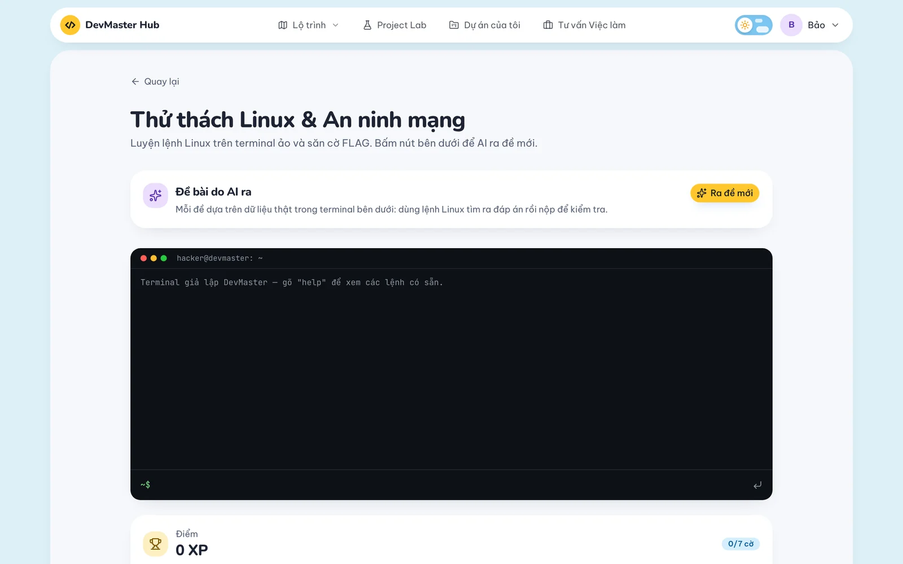
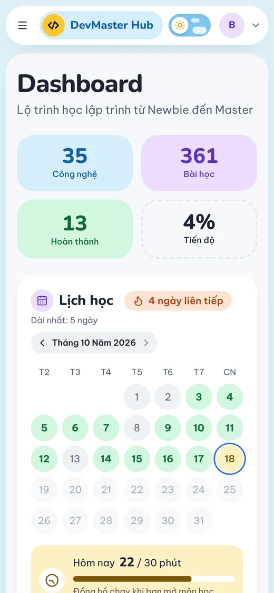
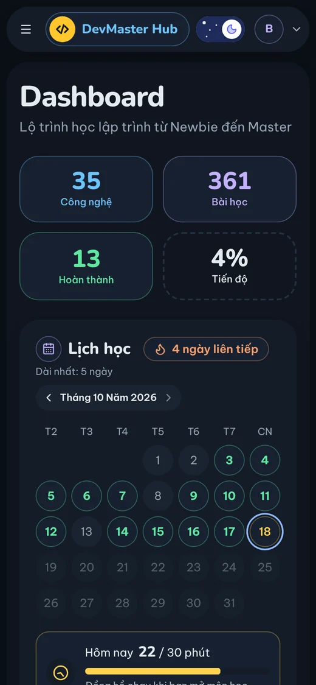

  <a href="https://devmaster-hub.onrender.com">
    <picture>
      <source media="(prefers-color-scheme: dark)" srcset="docs/readme/banner-toi.webp">
      
    </picture>
  </a>

  

  
  
  
  
  

  <b>Đọc lý thuyết. Chạy code ngay trên trình duyệt. Làm quiz, làm bài tập, làm dự án.</b> 
  Gia sư AI ngồi cạnh từng bài: gợi hướng để bạn tự nghĩ, không đưa đáp án.

---

## Một lộ trình, năm cấp độ

  
  &nbsp;→&nbsp;
  
  &nbsp;→&nbsp;
  
  &nbsp;→&nbsp;
  
  &nbsp;→&nbsp;
  

Mỗi công nghệ là một tuyến đường: đi hết cấp này mới mở cấp sau, bài nào xong là một ga được tô màu. Luôn biết mình đang ở đâu và bước tiếp theo là gì.

<picture>
  <source media="(prefers-color-scheme: dark)" srcset="docs/readme/lo-trinh-toi.webp">
  
</picture>

## 35 công nghệ, từ ngôn ngữ đến DevOps

<picture>
  <source media="(prefers-color-scheme: dark)" srcset="docs/readme/cong-nghe-toi.webp">
  
</picture>

## Bảng học của riêng bạn

Lịch học cả tháng, chuỗi ngày học liên tiếp, mục tiêu số phút mỗi ngày và nút **Vào bài học** đưa bạn thẳng tới đúng bài đang dở. Mở web lên là học tiếp, không phải tìm.

<picture>
  <source media="(prefers-color-scheme: dark)" srcset="docs/readme/dashboard-toi.webp">
  
</picture>

## Mỗi bài học là một vòng khép kín

| | |
|---|---|
| **Lý thuyết** | Ngắn gọn, có điểm chính tóm tắt cuối bài |
| **Code Lab** | Code mẫu tô màu, bấm **Chạy Code** là chạy thật: Python, SQL (PostgreSQL) và Lua chạy ngay trong trình duyệt; C++, Java, Go, Rust, C#, Kotlin, Swift, PHP, Ruby… biên dịch trên máy chủ |
| **Trắc nghiệm** | Câu hỏi do AI sinh theo đúng nội dung bài |
| **Bài tập** | Viết code và nhận chấm điểm, nhận xét từ AI |
| **Gia sư AI** | Hỏi bất cứ lúc nào, trả lời đúng ngôn ngữ bạn đang dùng |

<picture>
  <source media="(prefers-color-scheme: dark)" srcset="docs/readme/bai-hoc-toi.webp">
  
</picture>

## Thực hành như làm thật

- **Live IDE**: sửa HTML, CSS, JS và xem trang thay đổi ngay; chế độ Thiết kế cho phép chỉnh giao diện bằng AI.
- **Terminal Linux mô phỏng**: gõ lệnh thật, có hệ thống tệp riêng, chạy ngay trong trình duyệt.
- **Phòng lab Nginx**: cấu hình máy chủ web theo từng nhiệm vụ.
- **Thử thách CTF**: AI ra đề từ chính dữ liệu trong máy, dùng lệnh Linux để săn cờ `FLAG{...}` và tích điểm XP.

<picture>
  <source media="(prefers-color-scheme: dark)" srcset="docs/readme/thu-thach-toi.webp">
  
</picture>

## Từ học sang đi làm

- **Project Lab**: AI gợi ý ý tưởng dự án theo cấp độ hoặc chủ đề bạn muốn, có mentor chat đi kèm; nộp code để được chấm theo 4 tiêu chí.
- **Cố vấn việc làm**: tư vấn định hướng dựa trên chính tiến độ học của bạn, đọc được cả link tin tuyển dụng bạn dán vào.
- **Tìm việc**: gom tin từ VietnamWorks, RemoteOK, Arbeitnow, Remotive và WeWorkRemotely, kèm tỉ lệ phù hợp với hồ sơ của bạn.

## Học mọi lúc, sáng hay tối

<table>
  <tr>
    <td width="50%"></td>
    <td width="50%"></td>
  </tr>
</table>

Chạy mượt trên điện thoại, có chế độ sáng và tối, giao diện có 8 ngôn ngữ: Tiếng Việt, English, 日本語, 한국어, 中文, Français, Deutsch, Español.

## Xây dựng bằng

  
  
  
  
  
  

---

  <a href="https://devmaster-hub.onrender.com"><b>devmaster-hub.onrender.com</b></a> 
  © 2026 kabao0905. Mọi quyền được bảo lưu.

